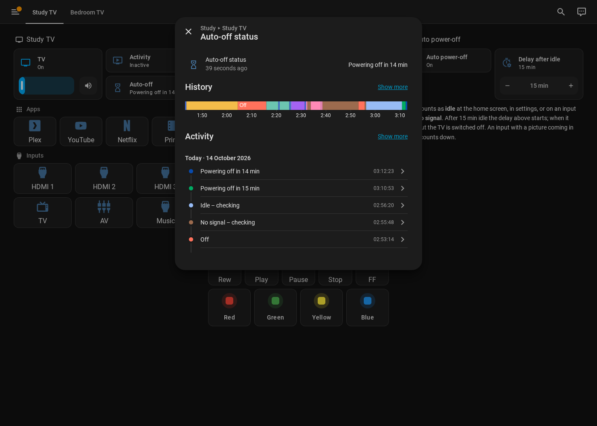
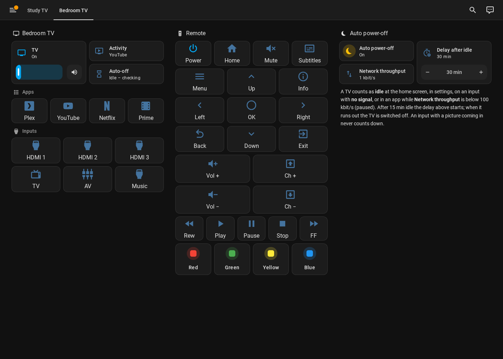
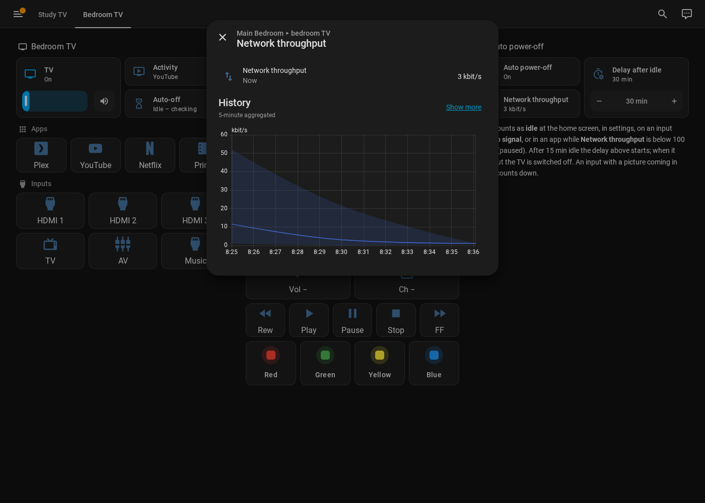
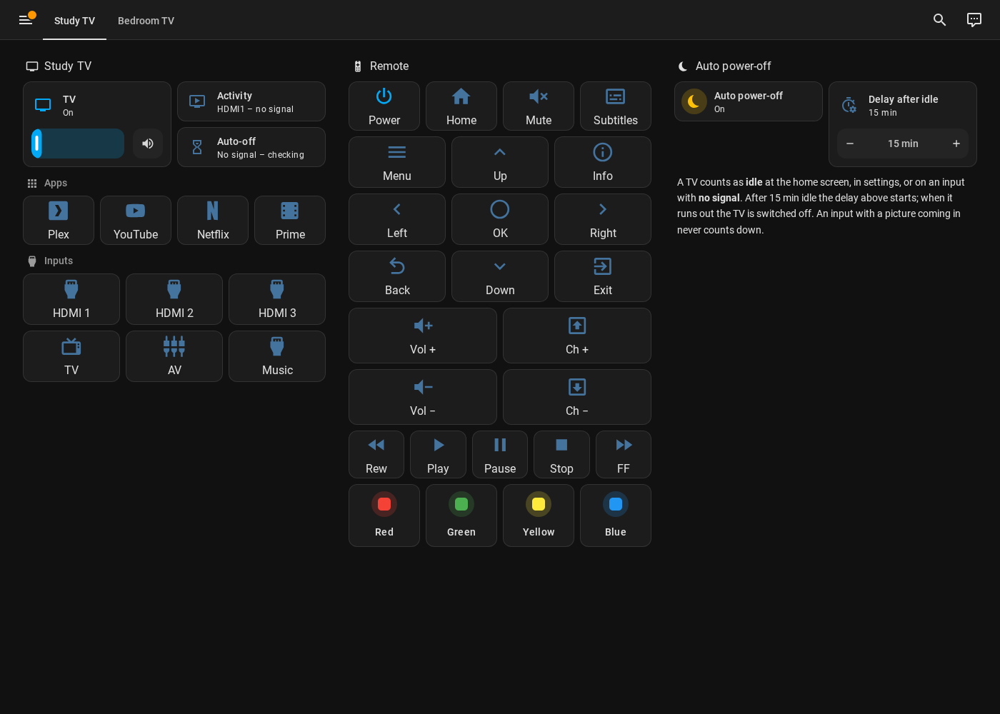

# VIDAA Eco

Control your **Hisense VIDAA** TV from [Home Assistant](https://www.home-assistant.io/) —
power, volume, inputs, apps and every practical remote button — and, if you want,
let it **switch the TV off by itself** when it has been left on with nothing to watch.

- **Just want a remote?** Pair the TV and you are done: a media player, a remote
  entity and a button for every key, app and input, ready for dashboards, scenes
  and voice assistants. Nothing else to set up.
- **Want automatic power-off too?** Turn on the TV's *Auto power-off* switch and
  give it a [network throughput sensor](#network-throughput-for-auto-power-off)
  (usually found automatically if you use UniFi or another router integration).

Everything runs on your own network. No cloud account is needed.


> **Built on** [ha_vidaatv](https://github.com/warrenrees/ha_vidaatv) and
> [pyvidaa](https://github.com/warrenrees/pyvidaa) by **Warren Rees**. VIDAA Eco
> is a fork that extends that work — huge thanks for the protocol
> reverse-engineering and the pairing implementation that make this possible.
> See [`NOTICE`](NOTICE).

---

## Contents

1. [What you get](#what-you-get)
2. [Before you start](#before-you-start)
3. [Install](#install)
4. [Add your TV (pairing)](#add-your-tv-pairing)
5. [Entities explained](#entities-explained)
6. [Automatic power-off explained](#automatic-power-off-explained)
   - [Network throughput](#network-throughput-for-auto-power-off)
7. [Options (after setup)](#options-after-setup)
8. [A remote-control dashboard](#a-remote-control-dashboard)
9. [Using it in automations and scenes](#using-it-in-automations-and-scenes)
10. [Playing media on the TV](#playing-media-on-the-tv)
11. [How the TV's power state is detected](#how-the-tvs-power-state-is-detected)
12. [Troubleshooting](#troubleshooting)
13. [Credits & licence](#credits--licence)

---

## What you get

For every TV you add, VIDAA Eco creates one **device** in Home Assistant with:

| Entity | What it does |
|---|---|
| **TV** (media player) | On/off (including Wake-on-LAN), volume, mute, input and app selection, play/pause, and **play media** (music, videos, pictures, TTS) from Home Assistant's media browser via the TV's built-in DLNA player |
| **Remote** (remote) | Send any remote key from automations with `remote.send_command` |
| **Activity** (sensor) | What is on screen: `YouTube`, `HDMI1`, `HDMI1 – no signal`, `TV: SABC 3`, `Inactive`, `Off` |
| **Auto-off status** (sensor) | What automatic power-off is doing: `In use`, `HDMI1 in use – no timer`, `No signal – checking`, `Powering off in 12 min` … |
| **Network throughput** (diagnostic sensor) | The TV's network traffic in kbit/s as used by auto power-off, where it comes from, and a link to [the setup guide](#network-throughput-for-auto-power-off) when none is set up |
| **Auto power-off** (switch) | Turn automatic power-off on or off for this TV (off by default) |
| **Auto-off delay** (number) | Minutes to wait (after the TV is confirmed idle) before switching it off |
| **Buttons** | One per remote key — Up, Down, Left, Right, OK, Back, Home, Menu, Exit, Info, Play, Pause, Stop, Rewind, Fast forward, Subtitles, Mute, Volume ±, Channel ±, Red, Green, Yellow, Blue |
| **App buttons** | Plex, YouTube, Netflix, Prime Video |
| **Input buttons** | One per input your TV reports — usually TV, HDMI1, HDMI2, HDMI3, AV |

Buttons are greyed out while the TV is off (it cannot receive keys until it is on).

---

## Before you start

You need:

1. **Home Assistant** — any installation type. New to it? Start at
   [home-assistant.io/installation](https://www.home-assistant.io/installation/).
2. **HACS** (the Home Assistant Community Store) — the easiest way to install and
   update custom integrations like this one. Install it by following
   [hacs.xyz/docs/use](https://hacs.xyz/docs/use/).
3. **A Hisense / VIDAA TV on the same network** as Home Assistant, switched on
   for the first setup. Give it a fixed IP address in your router (a "DHCP
   reservation") so Home Assistant can always find it.
4. **The VIDAA client certificate** — two small files, `vidaa_client.pem` and
   `vidaa_client.key`. Most VIDAA TVs only accept connections from the official
   app, which proves itself with this certificate. It belongs to Hisense, so it
   is **not** included here; the upstream project explains how to extract it
   from the official VIDAA app: see
   [ha_vidaatv → Obtaining the client certificate](https://github.com/warrenrees/ha_vidaatv#readme).
   Copy both files into a folder called **`certs`** inside your Home Assistant
   configuration folder (so you end up with `config/certs/vidaa_client.pem` and
   `config/certs/vidaa_client.key`). The
   [File editor](https://www.home-assistant.io/common-tasks/os/#installing-and-using-the-file-editor-app)
   or [Samba share](https://github.com/home-assistant/addons/blob/master/samba/DOCS.md)
   apps make this easy.
   *Some older TVs speak plain MQTT and need no certificate — see
   [Use SSL/TLS](#add-your-tv-pairing) below.*
5. **Optional – Wake-on-LAN enabled on the TV** so Home Assistant can switch it
   *on* (switching off always works). On most VIDAA TVs: **Settings → Network →
   Wake on LAN** (sometimes called *Wake on Wireless Network*).

---

## Install

### Option A — HACS (recommended)

1. Open **HACS** in the Home Assistant sidebar.
2. Open the menu (⋮, top right) → **Custom repositories**.
3. Paste `https://github.com/VibeOps-ZA/vidaa_eco`, choose type
   **Integration**, click **Add**.
   ([What is a custom repository?](https://hacs.xyz/docs/faq/custom_repositories/))
4. Search HACS for **VIDAA Eco**, open it, click **Download**.
5. **Restart Home Assistant**: **Settings → System → ⏻ (top right) → Restart Home Assistant**.

### Option B — Manual

1. Download this repository (green **Code** button → **Download ZIP**).
2. Copy the folder `custom_components/vidaa_eco` into your Home Assistant
   `config/custom_components/` folder (create `custom_components` if it doesn't exist).
3. Restart Home Assistant.

---

## Add your TV (pairing)

1. **Switch the TV on** and leave it on the home screen.
2. In Home Assistant go to **Settings → Devices & services**.
   - If the TV shows under **Discovered**, click **Add** next to it.
   - Otherwise click **+ Add integration**, search for **VIDAA Eco**, and enter:
     - **Host** – the TV's IP address (e.g. `192.168.1.50`).
     - **Port** – leave as `36669`.
3. **Certificates** step:
   - **Use SSL/TLS** – leave **on** for almost every TV. Turn it off only if setup
     fails to connect and your TV is older firmware that speaks plain MQTT; then
     no certificate is needed.
   - **Certificate file path / Key file path** – leave the defaults if you placed
     the files in `config/certs/` as above.
   - **Authentication mode** – leave on **Auto**. It detects your TV's protocol
     and falls back automatically. Choose **Static** only if an older TV fails
     with a "not authorised" error; **Dynamic** forces the newer scheme.
4. Click **Submit** and **be patient** — talking to the TV can take up to a
   minute while it tries the right connection method.
5. A **4-digit PIN appears on the TV**. Type it into Home Assistant and submit.
6. Done. Pick the room (area) the TV is in, and the device and its entities appear.

Repeat for each TV.

---

## Entities explained

Entity IDs are built from the TV's name. For a TV called *Study TV* you get
`media_player.study_tv`, `sensor.study_tv_activity`, `button.study_tv_ok` and so on.

### Activity sensor

| Shows | Meaning |
|---|---|
| `YouTube`, `Netflix`, … | That app is open |
| `HDMI1` | That input is selected and a picture is coming in |
| `HDMI1 – no signal` | That input is selected but nothing is connected / the device is asleep |
| `TV: <channel>` | Watching live TV |
| `Inactive` | Home screen or a settings menu |
| `Off` | TV is off |

Attributes include `statetype` (the TV's raw state), `source`, `channel_name`,
`signal` (`yes`/`no` on an input) and `signal_detail` (the raw signal flags for
every input — handy for troubleshooting).

### Auto-off status sensor

| Shows | Meaning |
|---|---|
| `Off` | TV is off |
| `Auto-off disabled` | The **Auto power-off** switch is off |
| `In use` | Something is on that you would not want switched off |
| `HDMI1 in use – no timer` | On an input with a picture coming in — never counts down |
| `Idle – checking` / `No signal – checking` | Looks idle; the 15-minute confirmation window is running |
| `Powering off in N min` | Idle confirmed; your delay is counting down |

For automations use its `status` attribute, which never changes wording:
`off`, `disabled`, `active`, `hdmi`, `idle`, `countdown`. Other attributes:
`idle_since`, `idle_minutes`, `minutes_remaining`, `power_off_at`.



---

## Automatic power-off explained

Off by default — switch **Auto power-off** on for each TV you want it on.

It works in two stages so it never surprises you:

1. **Confirm idle (15 minutes, fixed).** The TV has to look idle the whole time.
2. **Your delay.** Only then does **Auto-off delay** start counting. If the TV is
   still idle when it reaches zero, it is switched off.

So with the delay set to 30, an idle TV goes off **15 + 30 = 45 minutes** after
it went idle. Anything that counts as activity — changing channel, opening an
app, a picture appearing on an input, even a volume or mute change — resets both
stages. If the TV is switched off some other way before the countdown ends, the
timer simply clears.


**What counts as idle**

| Situation | Idle? |
|---|---|
| Home screen or a settings menu | Yes |
| An HDMI / AV input with **no signal** (nothing connected, or the device is asleep) | Yes. Many TVs also switch themselves to standby after ~15 minutes with no signal — whichever comes first wins. |
| An HDMI / AV input with a **picture coming in** | **No** — shows "*input* in use – no timer". The TV can't tell whether you are watching a connected device, so let that device sleep (most do, and HDMI-CEC can switch the TV off with it). |
| Live TV | No |
| Inside an app (YouTube, Plex, …) playing | No |
| Inside an app, paused or idle (traffic below the floor) | Yes — needs a [throughput sensor](#network-throughput-for-auto-power-off) |

**How "signal" is detected.** The TV reports a signal flag for every input
(`has_signal`) each time it is asked, plus a snapshot taken at the moment you
switch input. VIDAA Eco asks every poll while an input is selected and treats
the input as in use if either says a picture is present. The input's other flag
(`is_signal`) only marks which input is selected, so it is not used.

### Network throughput (for auto power-off)

**Needed only if you use Auto power-off.** Inside an app the TV reports the same
thing whether a film is playing or paused, so VIDAA Eco looks at the TV's
**network traffic**: above the **floor** (default 100 kbit/s) means something is
streaming; below it, the app counts as idle and the timer may start. The TV does
not report its own traffic, so the number comes from another integration —
usually your router or Wi-Fi system.

Because of that, VIDAA Eco **asks for a throughput source before Auto power-off
can be switched on**, and shows a notice in **Settings → Repairs** if one goes
missing later.

#### Step 1 – make the traffic visible in Home Assistant

Pick whichever matches your network:

- **UniFi** (UDM, Cloud Key, UniFi OS console) –
  [UniFi Network integration](https://www.home-assistant.io/integrations/unifi/):
  **Settings → Devices & services → UniFi Network → Configure**, open the
  advanced / more options section and tick the **bandwidth sensors** option
  (*Bandwidth usage sensors for network clients*). Each client (including your
  TV) gets an *RX* and a *TX* sensor in MB/s. Note: this creates two sensors for
  **every** client and they update every few seconds, which grows the
  Home Assistant database; on small systems you can disable the ones you don't
  need, or exclude them from the [recorder](https://www.home-assistant.io/integrations/recorder/).
  Tip: TVs on a Wi-Fi system that isn't UniFi (Ruckus, mesh kits …) still show up,
  as "wired" clients — that works too.
- **Ruckus Unleashed / ZoneDirector Wi-Fi** – the companion integration
  *Ruckus Client Throughput* (VibeOps-ZA, not published yet) adds a
  *Wi-Fi throughput* sensor per chosen client from the access points' own
  counters. Those counters refresh about once a minute, so it reacts within
  ~1 minute.
- **Other routers** that publish per-client traffic, e.g.
  [MikroTik](https://www.home-assistant.io/integrations/mikrotik/) or OpenWrt.
- **Anything with a byte counter** (SNMP, a managed switch port): read it with the
  [SNMP integration](https://www.home-assistant.io/integrations/snmp/) and turn it
  into a rate with a [Derivative helper](https://www.home-assistant.io/integrations/derivative/).

> **AirPlay, casting and DLNA from a phone on the same Wi-Fi:** that traffic goes
> phone → access point → TV and never passes the router, so a router-based sensor
> (UniFi, MikroTik …) reads ~0 while you stream. If you do that, add a source from
> the **Wi-Fi system** too (e.g. Ruckus above). VIDAA Eco adds all sources together,
> so router + Wi-Fi sensors side by side is fine.

Any **data-rate unit** works (bit/s, kbit/s, Mbit/s, kB/s, MB/s …) — VIDAA Eco
converts it.

#### Step 2 – let VIDAA Eco use it

- **Automatic (default).** VIDAA Eco looks for data-rate sensors on any device
  that has one of the TV's **MAC addresses** — that is how router integrations
  represent clients. With UniFi there is nothing else to do. Sensors that only
  describe a link's *speed* (e.g. "Link speed 1000 Mbit/s") are ignored.
- **Manual.** In the TV's options (next section) pick one or more sensors under
  **Throughput sensors (manual)**. Several sensors are **added together** — pick
  both the Wi-Fi and the Ethernet client if your TV can use either, or a separate
  download and upload sensor. A manual pick always wins over automatic.

#### Step 3 – check it

Open the TV's **Network throughput** sensor (device page → *Diagnostic*). It
shows the current kbit/s, `mode` (`manual`, `auto` or `none`) and every source
with its own value. Start a video: the number should jump to thousands of kbit/s;
pause it: it should drop under the floor.

The remote dashboard shows it next to the auto power-off settings — here an
open YouTube app with almost no traffic, so the TV counts as idle:





---

## Options (after setup)

**Settings → Devices & services → VIDAA Eco → Configure** on the TV:

| Option | What it does | Default |
|---|---|---|
| **Polling interval** | How often (seconds) to ask the TV what it is doing | 30 |
| **Wake-on-LAN MAC address** | Where to send the "wake up" packet. The TV's Ethernet and Wi-Fi addresses are listed in the dialog — if switching on doesn't work, try the other one | The TV's own |
| **Authentication mode** | Override the scheme chosen at pairing (Auto / Dynamic / Static). Only change if the TV starts refusing connections after a firmware update | As paired |
| **Find throughput sensors automatically** | Use data-rate sensors on devices that share the TV's MAC address. The ones found are listed in the dialog | On |
| **Throughput sensors (manual)** | One or more sensors with the TV's traffic, added together (see [Network throughput](#network-throughput-for-auto-power-off)). Required while Auto power-off is on, unless sensors were found automatically | None |
| **Throughput floor** | Below this total rate (kbit/s) an open app counts as "nothing playing" | 100 |

The **Auto power-off** switch and **Auto-off delay** number are ordinary
entities, so you can change them from a dashboard or an automation. Not using
Auto power-off? Leave all throughput options alone.

---

## A remote-control dashboard

A ready-made, remote-style dashboard using only Home Assistant's built-in cards
is in [`docs/dashboard.md`](docs/dashboard.md) — step-by-step instructions plus
the YAML to paste.

| Desktop | Phone |
|---|---|
|  |  |

---

## Using it in automations and scenes

Every button is a normal `button` entity, so in the automation editor choose
**Action → Button: Press** and pick e.g. `button.study_tv_hdmi1`.

```yaml
# Switch to HDMI 1 when the PlayStation turns on
actions:
  - action: button.press
    target:
      entity_id: button.study_tv_hdmi1
```

```yaml
# Tell me when a TV is about to switch itself off
triggers:
  - trigger: state
    entity_id: sensor.study_tv_auto_off_status
    attribute: status
    to: countdown
actions:
  - action: notify.notify
    data:
      message: "Study TV will switch off in {{ state_attr('sensor.study_tv_auto_off_status', 'minutes_remaining') }} min"
```

Other ways to control the TV:

- **Media player actions** – `media_player.turn_on`, `turn_off`, `volume_set`,
  `select_source` (inputs and app names from the TV's list).
- **Play media** – see [Playing media on the TV](#playing-media-on-the-tv).
- **Remote** – `remote.send_command` with any key, e.g. `KEY_OK`, `KEY_RETURNS`.

---

## Playing media on the TV

VIDAA TVs have a built-in **DLNA media player**. VIDAA Eco uses it so you can
send music, videos and pictures from Home Assistant straight to the TV:

- **Media browser:** open the TV's media player card → **Browse media** and pick
  anything from *My media*, *Text-to-speech*, *Radio Browser*, cameras and so on
  ([Media source docs](https://www.home-assistant.io/integrations/media_source/)).
- **From an automation:**

  ```yaml
  actions:
    - action: media_player.play_media
      target:
        entity_id: media_player.study_tv
      data:
        media_content_id: "https://example.com/video.mp4"   # or a media-source:// id
        media_content_type: video
  ```

- `media_content_type: app` with an app name still launches that app (e.g.
  `YouTube`).

Notes: the TV must be **on**. It plays common formats (MP4/H.264, MP3, AAC, JPEG …);
streams that need a login (Netflix etc.) can't be sent this way — open the app
instead. The TV's DLNA address changes on every restart, so VIDAA Eco picks it
up automatically from the TV's network announcements.

---

## How the TV's power state is detected

- **Polling:** every *Polling interval* (default 30 s) while the TV is reachable.
- **Instantly from the TV's announcements:** VIDAA TVs announce themselves on the
  network (SSDP) when they wake up and often say goodbye when they go to standby.
  VIDAA Eco listens for that and checks the TV immediately, so on/off shows up
  seconds sooner.
- **Sleeping TVs are left alone.** Some TVs drop off the network completely in
  standby. After 3 unanswered checks VIDAA Eco stops trying to reconnect and only
  re-checks **every 15 minutes** as a safety net, instead of knocking every few
  seconds all night. Any announcement from the TV, or switching it on from Home
  Assistant, brings normal polling straight back.
- **Switching on (Wake-on-LAN):** the "wake up" packet is sent to **every** MAC
  address the TV has reported (Wi-Fi and Ethernet), so it still works if you
  move the TV from Wi-Fi to a cable or back. Set *Wake-on-LAN MAC address* in the
  options to put a specific one first.

---

## Troubleshooting

| Problem | Try |
|---|---|
| Setup spins for a long time | Normal for up to a minute. Make sure the TV is on and awake. |
| No PIN appears on the TV | The TV must be on its home screen. Close the dialog, wait 30 s, try again. |
| "Certificate files not found" | Check the files are in `config/certs/` with exactly the names `vidaa_client.pem` and `vidaa_client.key`. |
| Can switch off but not on | Enable Wake-on-LAN on the TV, then try the other MAC address in the options. |
| "has not announced its media renderer yet" when playing media | The TV is off or hasn't announced itself since Home Assistant started — switch it on and try again a few seconds later. |
| TV shows off for a while after switching it on with its own remote | Normally the TV's announcement is picked up within seconds; if your network blocks multicast (SSDP), the 15-minute safety-net check catches it. |
| Buttons greyed out | The TV is off — buttons only work while it is on. |
| Auto-off never counts down | Check the switch is on; on an input it only counts down with **no signal**; in an app only when the **Network throughput** sensor is below the floor. The Activity sensor's `signal_detail` attribute shows what the TV reports. |
| "Pick a network throughput sensor" when switching Auto power-off on | No throughput source found — follow [Network throughput](#network-throughput-for-auto-power-off). |
| Network throughput shows `mode: none` | No sensor found for the TV's MACs. Check the router integration has per-client sensors enabled, or pick sensors manually. |
| Throughput never drops when paused | Some apps keep downloading in the background; raise the **Throughput floor**. |
| Need more detail | **Settings → Devices & services → VIDAA Eco → ⋮ → Enable debug logging**, reproduce, then download the log. |

---

## Credits & licence

Fork of [ha_vidaatv](https://github.com/warrenrees/ha_vidaatv) /
[pyvidaa](https://github.com/warrenrees/pyvidaa) by Warren Rees. MIT licensed —
see [`LICENSE`](LICENSE) and [`NOTICE`](NOTICE). Not affiliated with Hisense or VIDAA.
