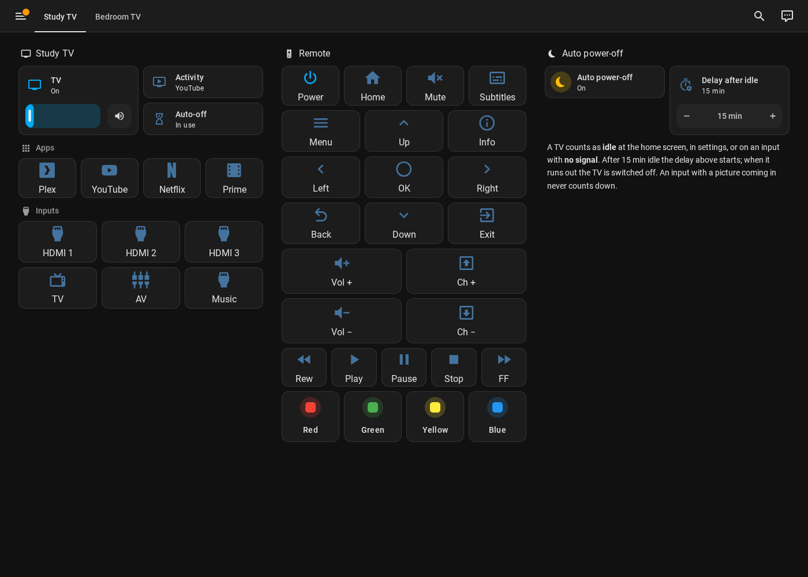
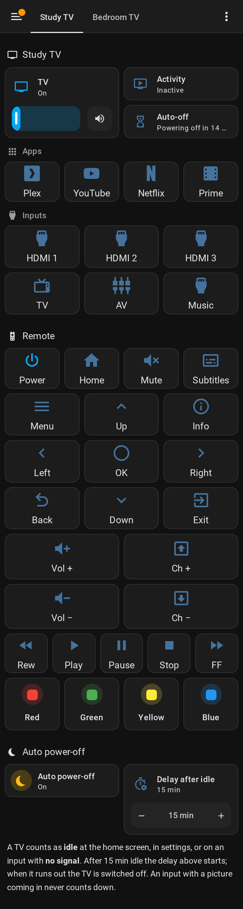

# A TV remote dashboard

This guide builds a dashboard that looks and works like a TV remote — one tab
per TV — using **only cards that come with Home Assistant**. Nothing extra to
install.

It shows, per TV:

- **Status** – the TV (on/off with a volume slider), what is on screen
  (**Activity**) and what automatic power-off is doing (**Auto-off**).
- **Apps** – Plex, YouTube, Netflix, Prime Video.
- **Inputs** – HDMI 1–3, TV, AV and Music sharing.
- **Remote** – Power, Home, Mute, Subtitles, a direction pad with OK and
  Menu / Info / Back / Exit around it, volume and channel, playback keys and the
  four colour keys.
- **Auto power-off** – the on/off switch, the delay and the TV's **Network
  throughput** (what auto power-off uses to tell a playing app from a paused one),
  with a one-line reminder of how it works. Using the dashboard only as a remote?
  Delete this section.

On a phone the three columns stack into one long remote:

## Step 1 – find your TV's entity names

1. Go to **Settings → Devices & services → VIDAA Eco** and open your TV.
2. Note the **media player** entity, e.g. `media_player.living_room_tv`.
3. Note the **prefix** of the other entities — the part before `_ok`, `_activity`
   and so on. For `button.living_room_tv_ok` the prefix is `living_room_tv`.

Usually both are the same. If your TV ended up as `media_player.living_room_tv_2`,
use that for the media player and the prefix of the buttons for the rest.

## Step 2 – create the dashboard

1. **Settings → Dashboards → + Add dashboard → New dashboard from scratch**.
2. Name it, e.g. **TV Remotes**, pick an icon (e.g. `mdi:remote-tv`), click **Create**.
3. Open the new dashboard from the sidebar.

([Official guide to dashboards](https://www.home-assistant.io/dashboards/).)

## Step 3 – paste the layout

1. Click the **pencil** (Edit dashboard) at the top right.
2. Open the **⋮** menu → **Raw configuration editor**.
3. Delete everything there and paste the contents of
   [`dashboard-example.yaml`](dashboard-example.yaml).
4. Use your browser's find-and-replace (or edit by hand) to change:
   - every `living_room_tv` → your prefix from step 1,
   - `media_player.living_room_tv` → your media player,
   - `Living Room TV` / `living-room` → your TV's name and a short URL name.
5. Click **Save**, then **Done**.

([Official guide to the raw configuration editor](https://www.home-assistant.io/dashboards/dashboards/).)

### More than one TV

Each TV is one **view** (tab). In the raw editor, copy the whole block that
starts at `- title: Living Room TV` down to the end, paste it again underneath,
and do the replacements for the second TV.

### Fewer inputs?

If your TV has no `HDMI3` or `AV`, delete those button blocks (each starts with
`- type: button` and contains the entity name) — or leave them; a button for an
input your TV doesn't report simply shows as *unavailable*.

## How the buttons work

Every button is a **Button card** that runs **button.press** on the matching
VIDAA Eco button entity, so pressing it on the dashboard is exactly like
pressing the key on the real remote. The **Power** button toggles the media
player (which also wakes the TV with Wake-on-LAN). Buttons are greyed out while
the TV is off.

Want to change the layout? Each group is a normal **Grid card** — use the visual
editor to move, remove or add buttons. Any VIDAA Eco button entity can be added
the same way.
